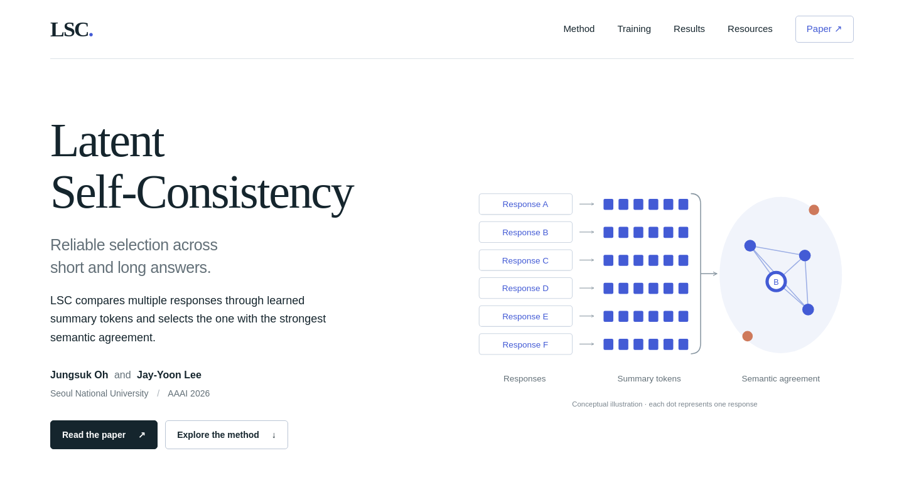

# Latent Self-Consistency (LatentSC)

Official implementation for Latent Self-Consistency (LSC): a latent-space self-consistency method for reliable majority-set selection in short- and long-answer reasoning.

[**Research website →**](https://jeongseoko.github.io/LatentSC/) · [Paper](https://arxiv.org/abs/2508.18395) · [Qwen3 8B checkpoint](https://huggingface.co/jeongseokoh/LatentSC_qwen3_8b_6SummaryTokens)

[](https://jeongseoko.github.io/LatentSC/)

The research website follows one question through candidate generation, special-token encoding, the similarity matrix, and response selection. It also explains dataset construction and summary-token training, LSC's contributions and differences from SC, WUCS, and USC, and the paper's quality/cost results across three models.

This repository is intended for public release. It does **not** store any API keys or private tokens. Please provide all credentials via environment variables.

---

## Quick start

```bash
# 1) Install deps
python3 -m pip install -r requirements.txt

# (Recommended) FlashAttention2 (GPU only, requires compatible CUDA + PyTorch)
python3 -m pip install flash-attn --no-build-isolation

# 2) Run inference (example)
MODEL=jeongseokoh/LatentSC_qwen3_8b_6SummaryTokens DATASET=MATH bash run.sh
```

If FlashAttention2 is not available, you can switch attention implementation:
```bash
ATTN_IMPL=sdpa MODEL=jeongseokoh/LatentSC_qwen3_8b_6SummaryTokens DATASET=MATH bash run.sh
```

---

## Datasets

Supported datasets (by default in `inference.py`):
- GSM8K
- MATH
- TriviaQA
- MMLU
- TruthfulQA (generation + MC)
- CommonsenseQA
- CNN/DailyMail

### Generate datasets

All dataset artifacts are generated locally and are **not committed** to the repo.

```bash
# Generate raw data -> processed -> undersampled
bash dataset_generation/run.sh

# Mix undersampled datasets into a single JSONL
bash dataset_generation/data_mixing.sh
```

Outputs (generated locally):
- `dataset_generation/raw_data_*.jsonl`
- `dataset_generation/proc_data_*.jsonl`
- `dataset_generation/undersampled_*.jsonl`
- `dataset_generation/mixed_data.jsonl`

---

## Training

`train.sh` defaults to **mixed_data.jsonl**. If it does not exist, run the data mixing step above.

```bash
# Basic training
bash train.sh

# Change model or training options
MODEL=llama3.1_8b EPOCH=3 AGGR=mean REMOVE_EOS=True bash train.sh

# Use explicit special token strings instead of <|Summary1|>...
SPECIAL_TOKENS="<|Summary1|>,<|Summary2|>,<|Summary3|>,<|Summary4|>,<|Summary5|>,<|Summary6|>" bash train.sh
```

Push to HF Hub after training:
```bash
PUSH_TO_HUB=1 \
HF_REPO_ID=yourname/LatentSC_qwen3_8b_6SummaryTokens \
HUGGINGFACE_HUB_TOKEN=hf_xxx \
bash train.sh
```

Notes:
- If `HF_REPO_ID` is not provided, the script infers a repo name using your HF username.
- Training saves to `outputs/` and can upload the final model + tokenizer.

---

## Inference

```bash
# Use a Hugging Face repo directly
MODEL=jeongseokoh/LatentSC_qwen3_8b_6SummaryTokens DATASET=MATH bash run.sh

# Adjust knobs
NUM_PATH=10 LSC_TEMP=0.5 REMOVE_EOS=True bash run.sh

# Run only selected methods
METHODS=LSC,SC,WUCS bash run.sh
METHODS=LSC,LSC_dynamic,LSC_top5 bash run.sh
```

If the HF repo contains `config.json` with LSC fields, inference will auto-load:
- `lsc_num_special_tokens`
- `lsc_special_tokens` or `lsc_special_token_prefix`
- `lsc_aggr`
- `lsc_remove_eos`
- `lsc_score_temp`

Available method names:
- `LSC`
- `SC` (excluded for TruthfulQA generation and CNN/DailyMail)
- `WUCS`
- `USC`
- `Random`
- `LSC_dynamic`
- `LSC_topK` such as `LSC_top5`
- `EOS_pred`, `EOS_first`, `EOS_special` when `USE_EOS=True`

Timing output separates shared path generation from selection/reranking:
- `Shared generation avg time`: one shared generation pass used by all methods
- `Select Time`: method-specific selection/reranking time
- `E2E Time`: shared generation time + method selection time

---

## Sync LSC config to HF

If you need to populate `config.json` in your HF repo:

```bash
HUGGINGFACE_HUB_TOKEN=hf_xxx \
python3 tools/sync_hf_config.py \
  --repo yourname/LatentSC_qwen3_8b_6SummaryTokens \
  --num_special_tokens 6 \
  --aggr mean \
  --remove_eos True \
  --lsc_score_temp 0.5
```

For non-default token strings, pass `--special_tokens` or set `SPECIAL_TOKENS`.

---

## Evaluation notes

- **EvalPlus**: use the official EvalPlus repo. You can integrate LSC by editing the HF provider and prompts.
- **MSMARCO-NLG**: use the official MSMARCO-Question-Answering repo and generate `responses.json` for evaluation.

---

## Public release hygiene

This repository ships **only public-safe files**. The following are excluded via `.gitignore` and removed from the working tree:
- `logs/`, `outputs/`, `results/`, `responses/`
- Generated datasets (`dataset_generation/*.jsonl`, `raw_data_*`, `proc_data_*`, `undersampled_*`)
- HF cache (`.hf_home/`)

If you need to reproduce results, regenerate datasets locally with the scripts above.

---

## Environment variables

Common environment variables:
- `HUGGINGFACE_HUB_TOKEN` or `HF_TOKEN` for gated models / uploads
- `MODEL`, `DATASET`, `MAX_SAMPLES`, `NUM_PATH`, `METHODS`, `LSC_TEMP`, `REMOVE_EOS`, `AGGR`, `NUM_SPECIAL_TOKENS`, `SPECIAL_TOKENS`
- `USE_EOS`, `USE_EOS_SECOND`, `ATTN_IMPL`, `PYTHON_BIN`
- Training: `EPOCH`, `DATA_PATH`, `USE_MIXED_DATA`, `PUSH_TO_HUB`, `HF_REPO_ID`, `OUTPUT_DIR`

---

## License

Add your license here.
